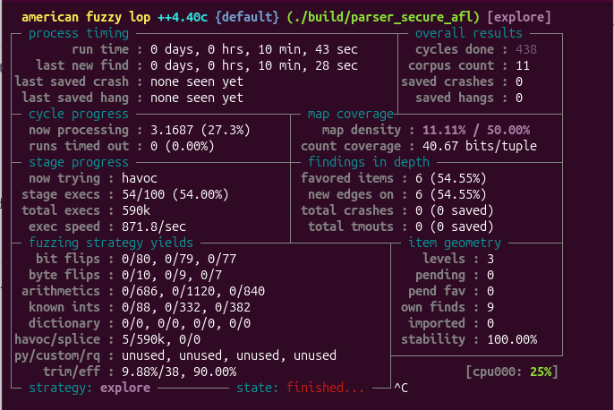

# File Parser Fuzzing Lab

A hands-on cybersecurity project exploring **memory-safety vulnerabilities in C** through coverage-guided fuzzing, runtime sanitizers, debugging, static analysis, and remediation.

> **Educational lab:** `parser.c` contains an intentional vulnerability. Do not use it to process untrusted files in production.

## Technologies

C · AFL++ · AddressSanitizer (ASan) · GDB · CodeQL · Ubuntu Linux

## Project workflow

| Phase | Documentation | Status |
| --- | --- | --- |
| 1. Vulnerability discovery | [AFL++ and ASan](docs/step1-fuzzing.md) | Completed |
| 2. Crash investigation | [GDB analysis](docs/step2-gdb-analysis.md) | Completed |
| 3. Static analysis | [CodeQL scan](docs/step3-codeql-analysis.md) | Completed |
| 4. Secure implementation and validation | [Secure parser](docs/step4-secure-parser.md) | Completed for the reported tests |

## Vulnerability and results

The custom binary format consists of a four-byte magic header (`FUZ1`), a one-byte payload length, and payload bytes. The vulnerable parser copies a user-controlled number of bytes into a 32-byte stack buffer without checking its capacity.

- **CWE-121:** Stack-based buffer overflow in `parser.c` (`memcpy`).
- **AFL++:** Found one unique crash in the vulnerable-parser campaign.
- **ASan and GDB:** Confirmed a 37-byte copy into a 32-byte buffer (5 bytes out of bounds).
- **CodeQL:** Reported a separate potential `cpp/path-injection` concern involving `fopen(argv[1], "rb")`; the selected query suite did not flag the confirmed buffer overflow.
- **Patched parser:** Rejects both known oversized test inputs; approximately 590,000 fuzzing executions in 10m 43s found zero crashes in the observed run.



*Secure-parser campaign: 0 saved crashes in the observed run. Zero detected crashes is not a guarantee of complete security.*

## Build

```bash
mkdir -p build
AFL_USE_ASAN=1 afl-clang-fast -g -O1 -fno-omit-frame-pointer \
  parser.c -o build/parser_afl
AFL_USE_ASAN=1 afl-clang-fast -g -O1 -fno-omit-frame-pointer \
  secure_parser.c -o build/parser_secure_afl
```

## Test

```bash
./build/parser_secure_afl seeds/valid.bin
# Optional: after preparing tests/overflow.bin
./build/parser_secure_afl tests/overflow.bin
```

## Fuzz

```bash
afl-fuzz -i seeds -o fuzz_output_secure -m none \
  -- ./build/parser_secure_afl @@
```

AFL++ may require a temporary Linux `core_pattern` configuration adjustment; see its diagnostic message. Generated builds, fuzzing outputs, and CodeQL databases should remain outside version control.

## Scope and limitations

The patched version addresses the confirmed stack-buffer overflow. It does **not** resolve the separate, context-dependent CodeQL path-injection finding, and a finite fuzzing run cannot establish the absence of every vulnerability.
