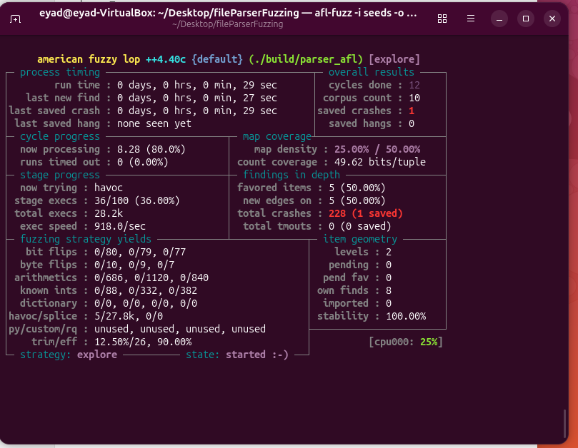

# Step 1 — Vulnerability Discovery with AFL++ and AddressSanitizer

## Objective

This phase of the **File Parser Fuzzing Lab** demonstrates how a memory-safety bug in a C binary file parser can be detected with AddressSanitizer (ASan) and explored using AFL++ coverage-guided fuzzing. The parser is intentionally vulnerable and is intended for use in a controlled educational laboratory.

## Environment

| Component | Used in this experiment |
| --- | --- |
| Operating system | Ubuntu Linux in VirtualBox |
| Language | C |
| Fuzzer | AFL++ 4.40c |
| Compiler | `afl-clang-fast` (LLVM-PCGUARD instrumentation) |
| Memory error detector | AddressSanitizer (ASan) |
| Parser source | `parser.c` |
| Instrumented binary | `build/parser_afl` |

## Parser and file format

The program receives a file path, reads binary data, verifies the `FUZ1` magic header, reads a one-byte payload length, checks that the file contains enough data, and copies the payload into a fixed-size stack buffer.

| File field | Bytes | Meaning |
| --- | --- | --- |
| Magic header | 4 | ASCII `FUZ1` |
| Payload length | 1 | Unsigned value from 0 to 255 |
| Payload | Variable | Data to copy |

The relevant code is:

```c
uint8_t length = input[4];

if (size < 5 + (size_t)length) {
    printf("Incomplete file\n");
    return 1;
}

unsigned char buffer[32];

// Intentionally vulnerable: no destination-size validation
memcpy(buffer, input + 5, length);
```

**Root cause:** Checking that the input *contains* `length` bytes does not ensure that the 32-byte destination buffer can *hold* `length` bytes. A file declaring, for example, a 50-byte payload can cause an attempted write of 18 bytes beyond the end of the destination buffer.

**Classification:** CWE-121 — Stack-based Buffer Overflow.

During testing, the parser was updated to use the copied data when computing a checksum. This made the copy observable and helped prevent optimization from eliminating the operation in the instrumented build. The bounds-check vulnerability was intentionally left in place.

## Build and test setup

The parser was compiled with AFL++ coverage instrumentation and ASan:

```bash
mkdir -p build
AFL_USE_ASAN=1 afl-clang-fast -g -O1 \
  -fno-omit-frame-pointer \
  parser.c -o build/parser_afl
```

The successful build reported **LLVM-PCGUARD** mode, **ASAN mode**, and **10 instrumented locations**.

A valid seed file can be created with:

```bash
mkdir -p seeds
printf 'FUZ1\x05hello' > seeds/valid.bin
```

Another valid seed at the capacity boundary uses a declared length of 32:

```bash
python3 - <<'PY'
with open('seeds/boundary32.bin', 'wb') as f:
    f.write(b'FUZ1' + bytes([32]) + b'A' * 32)
PY
```

## Automated AFL++ fuzzing

AFL++ ran the instrumented executable while mutating inputs from the `seeds` directory:

```bash
afl-fuzz -i seeds -o fuzz_output_round2 -m none \
  -- ./build/parser_afl @@
```

The `@@` marker is replaced by the generated test-file path for each execution.

### AFL++ results — screenshot evidence



*Figure 1. AFL++ dashboard from the second fuzzing campaign. The tool recorded one saved crash after approximately 28,200 executions. The image captures the run at 29 seconds.*

| Metric shown in screenshot | Observed value |
| --- | ---: |
| Run time | 29 seconds |
| Total executions | Approximately 28,200 |
| Execution speed | 918 executions/second |
| Corpus count | 10 |
| Total crashing executions | 228 |
| Unique saved crashes | **1** |
| Saved hangs | 0 |
| Stability | 100% |

**Interpretation:** Multiple executions triggered crashes, but AFL++ saved one distinct crashing test case. The automatically generated crash must still be reproduced and analyzed before its exact cause is attributed to the same vulnerability observed in the manual ASan test.

## Manual AddressSanitizer confirmation

A separately constructed input declared a 50-byte payload:

```bash
mkdir -p tests
python3 - <<'PY'
with open('tests/overflow.bin', 'wb') as f:
    f.write(b'FUZ1' + bytes([50]) + b'A' * 50)
PY

./build/parser_afl tests/overflow.bin
```

AddressSanitizer reported:

```text
ERROR: AddressSanitizer: stack-buffer-overflow
WRITE of size 50
#1 ... in main ... parser.c:38:5
```

ASan identified the local variable `buffer` at stack offsets `[1184, 1216)`, confirming that the write reached beyond the 32-byte allocation.

These observations confirm the intentionally introduced **stack-buffer-overflow** in the manual test. The AFL++ campaign separately established that the instrumented parser can be made to crash through automated input mutation.

## Outcome and next steps

**Completed:** Implemented the vulnerable parser, compiled it with AFL++ and ASan, verified the overflow with ASan, and saved an automatically generated crashing input with AFL++.

**Next:** Reproduce the saved AFL++ input, examine the failure with GDB, document the root cause, run CodeQL static analysis, add a bounds-checked parser, and verify that the corrected implementation rejects oversized payloads.

> **Safety note:** This intentionally vulnerable example is for local, controlled cybersecurity training. Do not use the vulnerable parser to process untrusted files in a production system.
