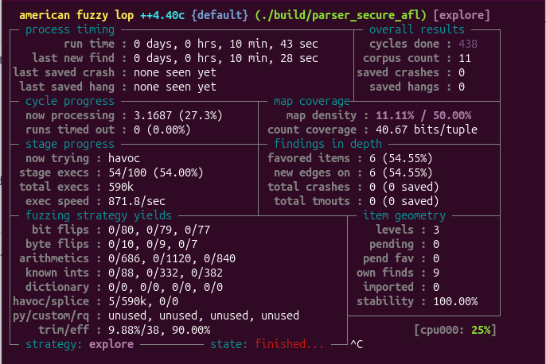

# Step 4 — Secure Parser Implementation and Validation

## Objective

Fix the **stack-based buffer overflow (CWE-121)** identified in the original C file parser, verify the patch using the previously crashing inputs, and run a second AFL++ campaign against the corrected implementation.

This phase builds on:

- [Step 1 — AFL++ fuzzing and ASan](step1-fuzzing.md)
- [Step 2 — GDB crash analysis](step2-gdb-analysis.md)
- [Step 3 — CodeQL static analysis](step3-codeql-analysis.md)

## Environment and tools

| Component | Used in this phase |
| --- | --- |
| Operating system | Ubuntu Linux (VirtualBox) |
| Language | C |
| AFL++ | 4.40c |
| Compiler | `afl-clang-fast` (LLVM PCGUARD instrumentation) |
| Memory checking | AddressSanitizer (ASan) |
| Vulnerable source | `parser.c` |
| Patched source | `secure_parser.c` |
| Fuzzer input corpus | `seeds/` |

## Root cause and fix

The original parser read a payload length directly from the fifth byte of a binary input file. Although the parser checked that enough bytes were present in the *input*, it did not verify that the *destination* had sufficient capacity:

```c
unsigned char buffer[32];
memcpy(buffer, input + 5, length);
```

For example, the AFL++-generated crash declared `length = 37`, but the destination could store only 32 bytes. The copy attempted to write **5 bytes beyond the buffer**.

The patched implementation preserves the existing file format but validates the destination capacity **before** copying:

```c
unsigned char buffer[32];

if ((size_t)length > sizeof(buffer)) {
    printf("Error: Payload exceeds buffer capacity\n");
    return 1;
}

memcpy(buffer, input + 5, length);
```

The patched parser also checks `ferror(file)` after `fread()` and uses a subtraction-based input-length validation after verifying that the file contains the five-byte header:

```c
if ((size_t)length > size - 5) {
    printf("Incomplete file\n");
    return 1;
}
```

These changes address the confirmed overflow and improve input handling. They should not be interpreted as a complete security audit of every possible file-system or parser behavior.

## Building the secure parser

From the repository root:

```bash
mkdir -p build
AFL_USE_ASAN=1 afl-clang-fast -g -O1 \
  -fno-omit-frame-pointer \
  secure_parser.c -o build/parser_secure_afl
```

The build completed successfully and reported **12 instrumented locations**, using LLVM PCGUARD in ASan mode.

## Regression tests

The patched executable was tested with a valid input and two inputs known to trigger the original vulnerability.

| Test case | Input | Observed result |
| --- | --- | --- |
| Valid seed | `seeds/valid.bin` (5-byte payload) | `Successfully parsed 5 bytes (checksum: 532)` |
| Manually constructed oversized input | `tests/overflow.bin` (50-byte payload) | `Error: Payload exceeds buffer capacity` |
| AFL++-generated crash | One 42-byte crash file from `fuzz_output_round2/default/crashes/` (37-byte payload) | `Error: Payload exceeds buffer capacity` |

Commands used:

```bash
./build/parser_secure_afl seeds/valid.bin
./build/parser_secure_afl tests/overflow.bin

CRASH=$(find fuzz_output_round2/default/crashes \
  -maxdepth 1 -type f -name 'id:*' -print -quit)
./build/parser_secure_afl "$CRASH"
```

**Result:** Both oversized payloads were rejected cleanly; neither produced an ASan report in the observed tests. A non-zero exit status for rejected input is expected behavior.

## Secure-parser AFL++ campaign

Command:

```bash
afl-fuzz -i seeds -o fuzz_output_secure -m none \
  -- ./build/parser_secure_afl @@
```

The fuzzer was stopped manually using `Ctrl+C` after approximately **10 minutes 43 seconds**. AFL++ saved its state for resumption.

### Observed results

| Metric | Secure parser |
| --- | ---: |
| Run time | 10 min 43 sec |
| Total executions | Approximately 590,000 |
| Execution speed at capture | 871.8/sec |
| Corpus count | 11 |
| Cycles completed | 438 |
| Saved unique crashes | **0** |
| Saved hangs | **0** |
| Stability | **100%** |

### AFL++ dashboard evidence



*Figure 1. Terminal screenshot from the secure-parser fuzzing campaign. No crashes or hangs were reported during this run.*

## Before and after

| Metric | Vulnerable `parser.c` | Patched `secure_parser.c` |
| --- | --- | --- |
| Fuzzing run time | Approx. 29 sec | Approx. 10 min 43 sec |
| Total executions | Approx. 28,200 | Approx. 590,000 |
| AFL++ saved unique crashes | **1** | **0** |
| Crashing executions shown | 228 | 0 |
| ASan reproduction with saved crash | Stack-buffer-overflow, 37-byte write | Oversized payload rejected |
| GDB root-cause analysis | 37 bytes requested, 32-byte buffer | Destination size is checked before `memcpy` |

**Interpretation:** The patched parser rejects the known crashing inputs and no crashes were discovered in the observed secure-parser fuzzing campaign. Because the two campaigns had different durations and explored different test cases, this comparison is evidence for the fix **but not proof that the parser is free of all vulnerabilities**.

## Remaining security considerations

CodeQL previously reported a potential `cpp/path-injection` issue because the application passes a caller-provided filename to `fopen()`. The fixed parser deliberately retains this command-line file-path interface, so that separate finding is **not remediated** here. Its relevance depends on who is allowed to supply file paths and whether file access must be restricted to a trusted directory.

The parser currently reads up to 1,024 bytes; support for larger files or strict rejection of trailing data would require a separate format-handling decision.

## Conclusion

Step 4 demonstrates a reproducible remediation workflow: use AFL++ and ASan to establish a memory-safety defect, confirm the cause using GDB, add a bound check in a separate secure implementation, rerun the original crashing input, and perform another fuzzing campaign. The observed data supports successful mitigation of the **confirmed 32-byte stack-buffer overflow**.

**Scope:** Educational testing in a controlled local environment.
